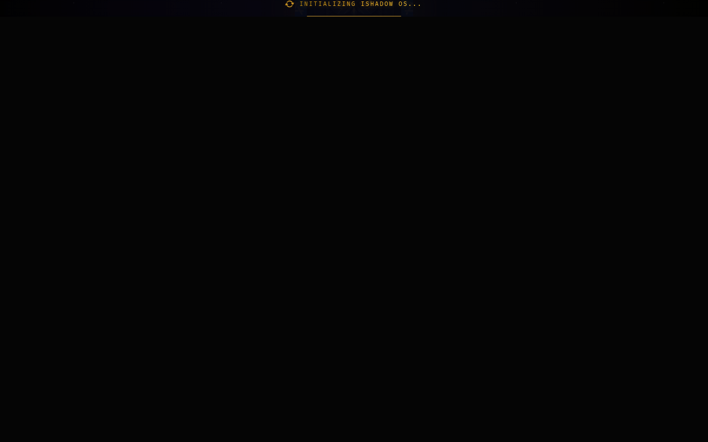

# iShadow / NightOwl

| | |
| --- | --- |
| Status | Prototype |
| Approx. date | July 2026, from the AI Studio stamp. Treat the month as approximate. |
| Screenshot | [Boot screen](screenshots/ishadow-boot-screen.png) |

## What it claims

The captured frame is a boot line, "Initializing iShadow OS." The project behind it is a market-intelligence console: scanners, a nightly briefing, account visibility, and an execute control, with an Android shell aimed at a foldable and a desktop layout.

## What the source does

The most substantial engineering in the market line. An Express server with SQLite and about 20 endpoints. From the handoff note and the code the review read:

- A real Fear & Greed index read.
- Binance klines used to tag market structure.
- CoinGecko and DexScreener scanners with liquidity, volume, and age filters.
- Nightly briefings written by Gemini, kept in a history archive.
- A Coinbase Advanced Trade accounts call that is **read-only**, authenticated with a JWT. The handoff records the diagnosis of that call: a missing `/api` prefix on the URL, and the URI covered by the signature.
- An execute endpoint that is an explicit mock and reports that it is standing by.

A Capacitor Android shell provides the foldable and DeX dual layout. A written handoff addresses a follow-on coding agent.

Credentials are read from the environment. The review checked the export and did not find a key committed in source. A damaged local database file and a client SDK configuration block were in the export. Both are omitted here.

The boot frame is the only public screenshot. It shows the init state, not the scanners running.

## Stack

Vite plus Express. SQLite. About 20 HTTP endpoints. Gemini for nightly briefings. Read-only Coinbase Advanced Trade (JWT). Public market-data APIs (Fear & Greed, Binance klines, CoinGecko, DexScreener). Capacitor Android shell.

## What it shows

Live integration testing and incident diagnosis on a real authenticated read. The page records market intelligence and a read-only account check. The execute path is a mock. The handoff is the same spec discipline as the caregiving exports.

