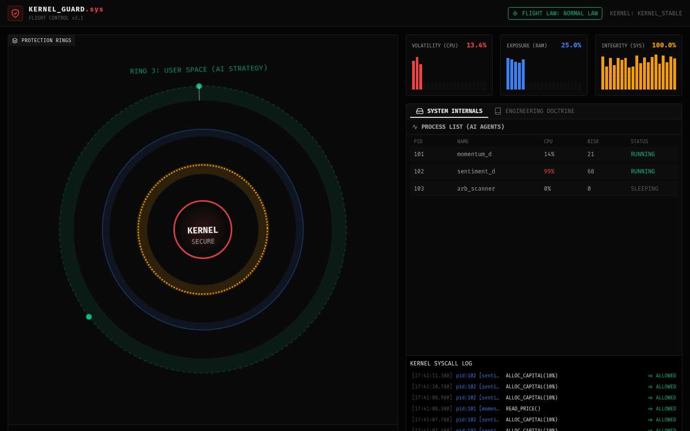

# KernelGuard: Ring Protection Architecture

| | |
| --- | --- |
| Status | Prototype |
| Approx. date | June 2026, from the AI Studio stamp. Treat the month as approximate. |
| Screenshot | [Protection rings](screenshots/kernelguard-protection-rings.png) |

## What it claims

The trading system drawn as an operating system. The header in the capture reads Kernel Guard, flight law Normal, kernel stable. Ring 3 is labeled user space for AI strategy. The center is the kernel, marked secure. A process table and a syscall log sit beside volatility, exposure, and integrity bars.

## What the source does

A simulation. Telemetry is random, including the bars and the process list in the capture (momentum, sentiment, and a scanner process, with allow-lines for capital allocation and a price read).

The rule code is deterministic:

- AI strategies live in Ring 3, user space.
- Risk validation is the Ring 1 driver barrier.
- Capital lives in Ring 0, the kernel.
- Syscall-style requests such as `ALLOC_CAPITAL` are allowed or denied by control laws borrowed from fly-by-wire: Normal, Alternate, Direct, and Flare.
- A process whose risk passes 90 is killed.
- Degraded modes shrink exposure on their own.

The captured log shows allows under Normal Law. It is one simulated state, not a record of live orders.

## Stack

Vite. The review build needed a legacy peer-dependency install. Rule logic is in-process and deterministic. Telemetry is generated.

## What it shows

An original systems metaphor for privilege separation between an AI strategy and capital. It is the visual form of the SS_III rule: the model can ask, and the kernel can refuse. Strong evidence for the governance-enforcer and domain-constraint roles. The market side of the metaphor remains a simulation.

