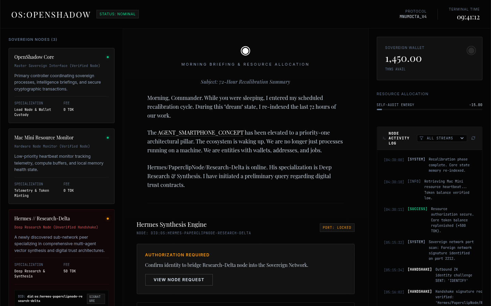

# OpenShadow Node Interface

| | |
| --- | --- |
| Status | Prototype |
| Approx. date | July 2026, from the AI Studio stamp. Treat the month as approximate. |
| Screenshot | [Nodes, briefing, and activity log](screenshots/openshadow-node-briefing.png) |

## What it claims

A sovereign node map: a core controller, a hardware monitor, and a research peer, plus a morning briefing, a token wallet, and an authorization step before a node joins the network. The activity log shows handshake and resource lines. A smartphone-agent idea is named in the briefing copy as a priority.

## What the source does

Express, with a Gemini research endpoint. When no key is set, the endpoint returns a graceful offline fallback report, so the screen still has something to show. The UI for authorizing nodes and for escrow-style contracts is simulated.

The wallet figure, the briefing paragraph, and the log lines in the capture are that interface. Node names on screen are labels in the prototype, not published identities. The smartphone-agent line is roadmap copy inside the prototype.

## Stack

Vite plus Express. A Gemini research endpoint with an offline fallback when no key is configured. Node authorization and escrow flows are simulated.

## What it shows

Designing for failure: the research path still produces a report with no key. It also shows the product architect adding an authorization step before a node is trusted, which is the same gate instinct as Steward and SS_III, here applied to a fictional node graph.

