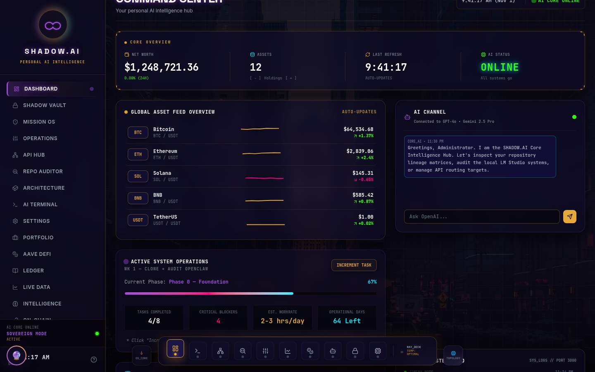

# Shadow.AI Command Center & Auditor

| | |
| --- | --- |
| Status | Prototype |
| Approx. date | April 15 and July 15, 2026, both written in the source. The app spans that window. |
| Screenshot | [Dashboard](screenshots/shadow-ai-command-center-dashboard.png) |

## What it claims

A personal AI intelligence hub: net worth, an asset feed, a repo auditor, an API hub, mission operations, and a chat channel connected to more than one model. The captured frame shows a large net-worth tile, sparkline prices, and a task called out as a repository audit.

## What the source does

The biggest Shadow app in the set: about 7,900 lines across 35 files.

Real in the export:

- An Express server with Gemini chat endpoints, including a "conscience" persona and a mission chat.
- A directive store.

Simulated in the export:

- The repo audit is the endpoint `/api/audit-sim`.
- API-hub pings are random, succeeding about 85 percent of the time inside that simulation.
- Market and exchange tiles are random.
- A key-lockdown console is present as a concept.

The net-worth tile and the price tiles in the screenshot are that simulated feed. Specific figures stay in the image and are left out of this text.

## Stack

Vite frontend. Express server. Gemini chat endpoints (conscience and mission). A directive store. About 7,900 lines, 35 files.

## What it shows

Ambitious UI composition: vault, missions, an API hub, an auditor entry, and a side chat in one shell. The auditor label is ahead of the code. What exists is a mock audit endpoint beside real chat endpoints. Treat "repository auditor" as a prototype control, not as a completed audit.

