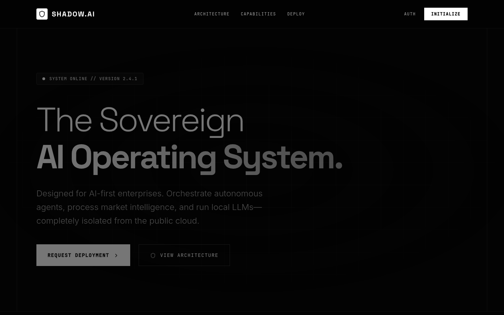

# SHADOW.AI Landing Page

| | |
| --- | --- |
| Status | Concept |
| Approx. date | June 2026, from the AI Studio stamp. Treat the month as approximate. |
| Screenshot | [Landing page](screenshots/shadow-ai-landing-page.png) |

Concept status means roadmap: a positioning piece, not a launched operating system.

## What it claims

"The Sovereign AI Operating System." The page says version 2.4.1, system online, and describes orchestration of autonomous agents, market intelligence, and local models isolated from the public cloud. Actions on the page are "Request deployment" and "View architecture," plus Architecture, Capabilities, Deploy, Auth, and Initialize in the header.

## What the source does

A static marketing page, about 550 lines. No agent runtime, no market feed, and no local-model host are behind the copy. It is a copy and layout exercise for the name Shadow.AI.

## Stack

Vite. Static page. About 550 lines.

## What it shows

Product-architecture language catching up with the prototypes: sovereign, isolated, agent-first. The version badge and the deployment button are part of the concept art. The systems those words point at are the other pages in this index, each with its own status.

