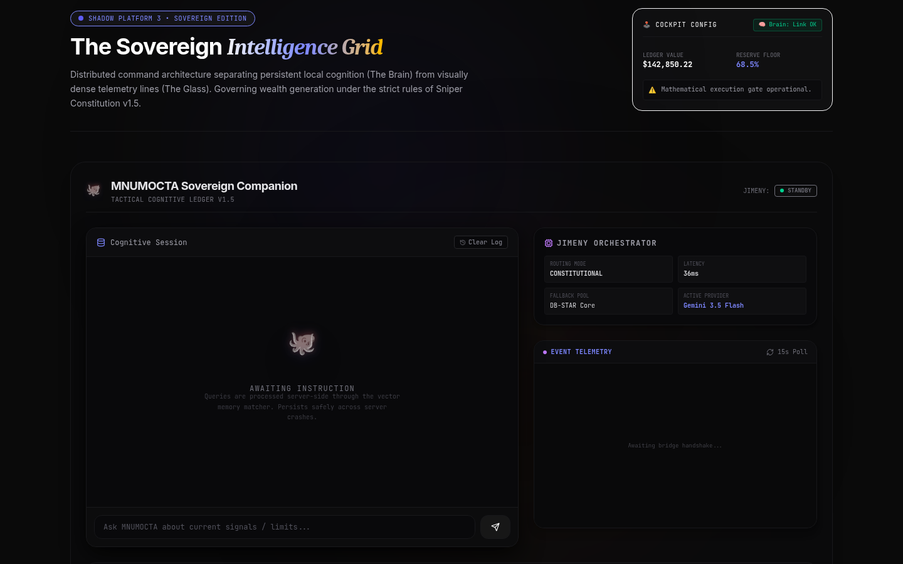

# Shadow AI Prototype

| | |
| --- | --- |
| Status | Prototype |
| Approx. date | October 2026, from the AI Studio stamp. Treat the month as approximate. |
| Screenshot | [Sovereign companion](screenshots/shadow-ai-prototype-companion.png) |

## What it claims

The captured frame is "The Sovereign Intelligence Grid": a split between persistent local cognition (the Brain) and dense telemetry (the Glass), under a "Sniper Constitution." A companion panel waits for an instruction. An orchestrator panel lists routing mode, latency, a fallback pool, and an active provider. A ledger value and a reserve-floor percentage sit in the header.

The project also includes simulators for a desktop menu-bar HUD and a phone Dynamic Island / bottom sheet, plus a mission console. Those simulators are not the frame shown here.

## What the source does

An Express server of about 840 lines, with endpoints for a ledger, config, and a gateway test. Gemini models on the server include a Flash-Lite id. Logs and bridge latency are randomized.

The ledger value and reserve percentage in the capture are prototype display, in the same family as the other simulated tiles in this set. They are not a published balance.

## Stack

Vite plus Express (about 840 lines). Gemini models including Flash-Lite. Desktop menu-bar and phone Dynamic Island / bottom-sheet simulators. A mission console. Randomized logs and bridge latency.

## What it shows

Product design for an ambient assistant: a quiet companion surface, an orchestrator readout, and device-frame simulators around a small real server. The constitution language in the header ties it back to the governance thread. The numbers in the header are simulated display.

