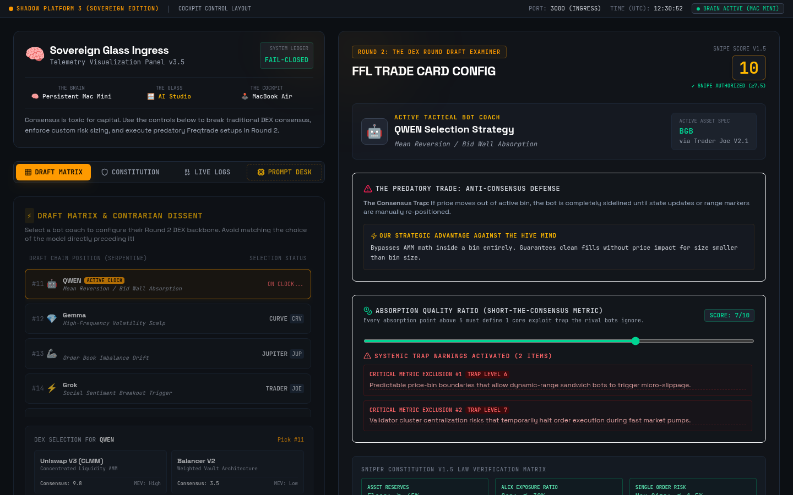

# Shadow Platform 3: Sovereign Glass

| | |
| --- | --- |
| Status | Prototype |
| Approx. date | July 2026, from the AI Studio stamp. Treat the month as approximate. |
| Screenshot | [Draft matrix and snipe gate](screenshots/shadow-platform-3-draft-matrix.png) |

## What it claims

A cockpit for a "DEX round draft examiner." The capture shows a Snipe Score, a strategy card (mean reversion / bid-wall absorption), trap warnings, a draft matrix of coach models, and a law-verification matrix. Copy on the page talks about breaking consensus and sizing risk. Machine roles in the header are labeled Brain, Glass, and Droplet.

## What the source does

One component, about 1,200 lines. The Snipe Score is deterministic and comes from constitution inputs:

- Reserve at or above 65 percent.
- Alt exposure at or below 30 percent.
- Per-order risk at or below 1.5 percent.
- A penalty when the venue is crowded.

A snipe is marked authorized only above 7.5. When order size exceeds the limit, the app writes a "risk crush" log. A law-verification matrix sits under the score. The log is labeled a simulation in the app.

Coach names, venue names, and the score in the captured frame (the frame shows a score of 10) are that simulation.

## Stack

Vite. A single component of about 1,200 lines. Scoring is local and deterministic. The in-app log is marked as a simulation.

## What it shows

A written rulebook turned into an executable gate, one step past the SS_III explainer. The product surface is still a prototype cockpit. Authorization on screen means the score cleared 7.5 inside the simulation.

