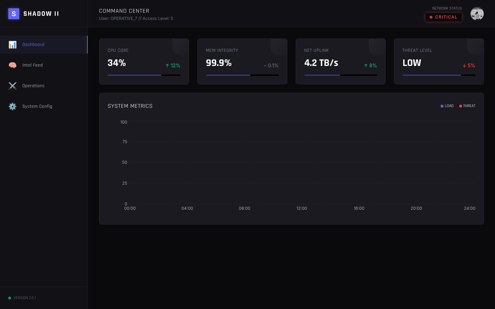

# Sovereign Shadow II Dashboard

| | |
| --- | --- |
| Status | Prototype |
| Approx. date | Late 2025 or early 2026, from `@google/genai` 1.30.x and Gemini 2.5 Flash. AI Studio stamp July 30, 2026, which is a bulk re-save, not a creation date. |
| Screenshot | [Metrics shell](screenshots/sovereign-shadow-ii-metrics.png) |

## What it claims

A command center: CPU, memory integrity, uplink, and threat level, plus a system-metrics chart.

## What the source does

A small app, about 550 lines. Gemini calls are real: a key ping, an analysis call, and streaming chat through Gemini 2.5 Flash. The metric bars are decorative. Widths are random. The chart in the captured frame is empty.

The header's operator label and the "critical" network pill are chrome. They are not evidence of an account or of an incident.

## Stack

Vite. `@google/genai` ^1.30. Model id `gemini-2.5-flash`, including a streaming chat path.

## What it shows

An early UI shell and a working basic Gemini integration, streaming included. The visual "system" around the chat is decoration. Later consoles reuse this command-center shape with more structure behind it.

