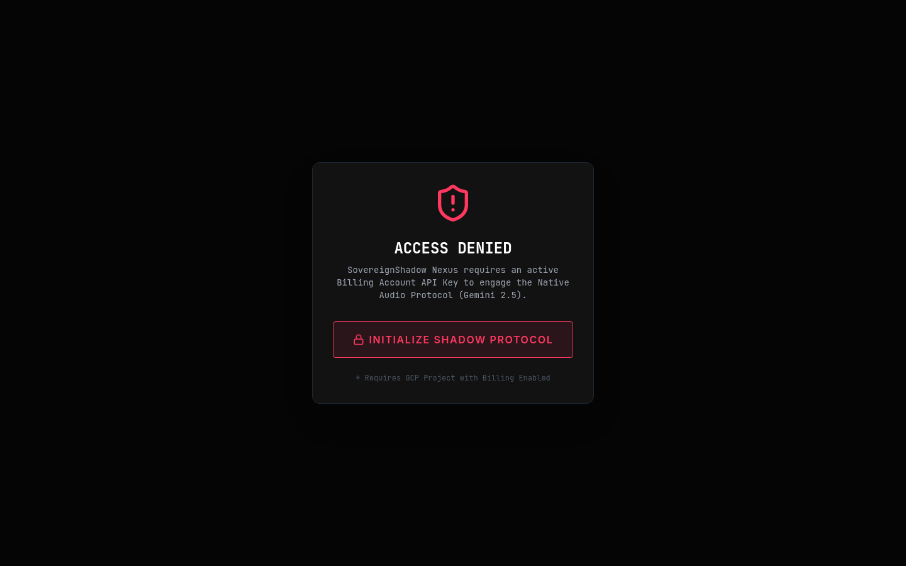

# SovereignShadow Assistant

| | |
| --- | --- |
| Status | Prototype |
| Approx. date | Built around November 21, 2025 (the date stated in the system prompt). AI Studio last updated June 19, 2026. |
| Screenshot | [Access gate](screenshots/sovereignshadow-assistant-access-gate.png) |

## What it claims

A unified voice interface for an autonomous trading system, with a Ray Score, safety rules, and a Brutal Critic.

## What the source does

The voice session is real: Gemini Live native audio (`gemini-2.5-flash-native-audio-preview`) driven by a long system prompt. Trade signals are simulated. Prices and scores are generated randomly, and a signal is approved when the score is above 60.

The durable content is the governance spec inside the prompt:

- A five-factor weighted score, threshold 60.
- A loss-limit ladder: per trade, daily, weekly, and an emergency stop.
- A hot/cold capital split.
- An adversarial Brutal Critic role that questions every signal.

Personal portfolio figures appear in that prompt. They are omitted here.

The captured frame is the gate shown when native audio is not configured: it asks for a billing-account key and a GCP project with billing enabled. No key is shown, and none is stored in this repo.

## Stack

Vite frontend. Gemini Live native-audio preview. `@google/genai` 1.30.x, consistent with the late-2025 model ids.

## What it shows

Explicit risk constraints and an adversarial reviewer, written into the agent's instructions before the later apps turn those ideas into a constitution and a gate. This is the start of the domain-constraint and governance thread. The trading behavior is a simulated experiment.

