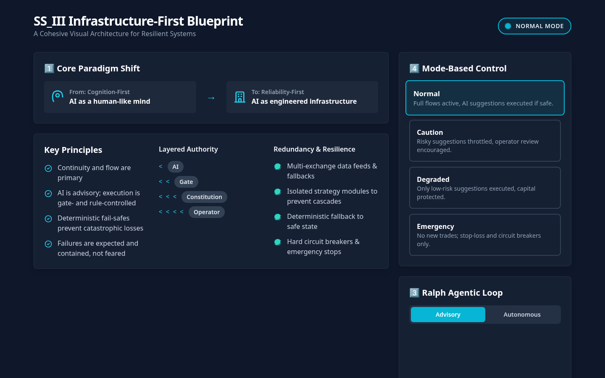

# SS_III Crypto Architecture Dashboard

| | |
| --- | --- |
| Status | Prototype |
| Approx. date | Around February 16, 2026, from `created_utc` in `constitution.json`. AI Studio stamp July 30, 2026 (bulk re-save). |
| Screenshot | [Infrastructure blueprint](screenshots/ss-iii-mode-blueprint.png) |

The private SPIII repository is a different body of work and is not public. This page covers the AI Studio explainer only.

## What it claims

An infrastructure-first blueprint. The on-screen shift is from "AI as a human-like mind" to "AI as engineered infrastructure." Modes run from Normal through Emergency. A Ralph agentic loop is shown as Advisory or Autonomous.

## What the source does

A visual explainer. Flow values on the animated diagram are random. The substance is `constitution.json`:

- Exposure caps, drawdown limits, an emergency threshold, and a cap on consecutive losses.
- An allow-list of assets.
- A mode table. Normal and Caution allow new positions. Degraded and Emergency block them.
- Fail-safes. Exchange failure moves the system to Degraded.
- An audit log of every recommendation, gate decision, and mode change.
- A hard rule for the agent named Ralph: it cannot open or close positions. It advises, and a gate has to pass.

Authority in that file runs from least to most: AI, then gate, then constitution, then operator. The operator outranks the constitution, the constitution outranks the gate, and the gate outranks the AI.

The blueprint's Normal-mode caption says suggestions run when they are safe. The constitution the review read is stricter than a slogan: Ralph does not open or close positions on its own. The Advisory / Autonomous control is part of the explainer UI.

## Stack

Vite. Static and animated presentation. The rule file is `constitution.json`.

## What it shows

The clearest artifact of **AI advises, rules decide**. Later gates (KernelGuard, Shadow Platform 3, Steward) are variations on this authority order. Market figures are not the point of the page, and the animated flows are not a live book.

