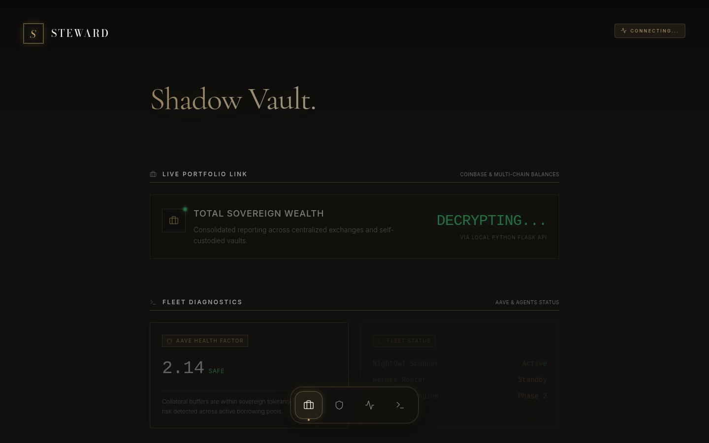

# Steward

| | |
| --- | --- |
| Status | Prototype |
| Approx. date | October 2026, from the AI Studio stamp. Treat the month as approximate. |
| Screenshot | [Shadow Vault](screenshots/steward-vault-diagnostics.png) |

Described in the project as "Jiminy — Cognitive Concierge."

## What it claims

A calm private concierge. The captured frame is the vault: a portfolio link, a wealth line that reads "Decrypting…", an AAVE health-factor tile, and a fleet list (scanner and router rows) under fleet diagnostics.

## What the source does

A four-tab operator console: portfolio, a "Hermes switch" hub, signals, and an agent-fleet code-execution view. The mechanic the review highlights is a human approval gate. Tasks move backlog → scanning → awaiting-gate → executed, and they need a manual authorization through a chat-style feed. The console keeps audit logs. An operator "tilt" state changes posture.

The socket client caps reconnects at three. A hosted websocket address was hard-coded in the export and is omitted here.

The wealth line in the capture is a placeholder. The health-factor tile is demo interface state, not a published borrowing position and not a result. Fleet rows are status labels in the prototype.

The concierge description is broader than the build. What is built is the operator console and the approval gate.

## Stack

Vite. A four-tab console. A websocket client with a reconnect cap of three. Chat-style approval feed and audit log.

## What it shows

Governance as a queue a person has to clear, which is the October form of "AI advises, rules decide." The positioning gap is part of the record: the public description says concierge, and the source is an operator console. The vault numbers are not a live book.

