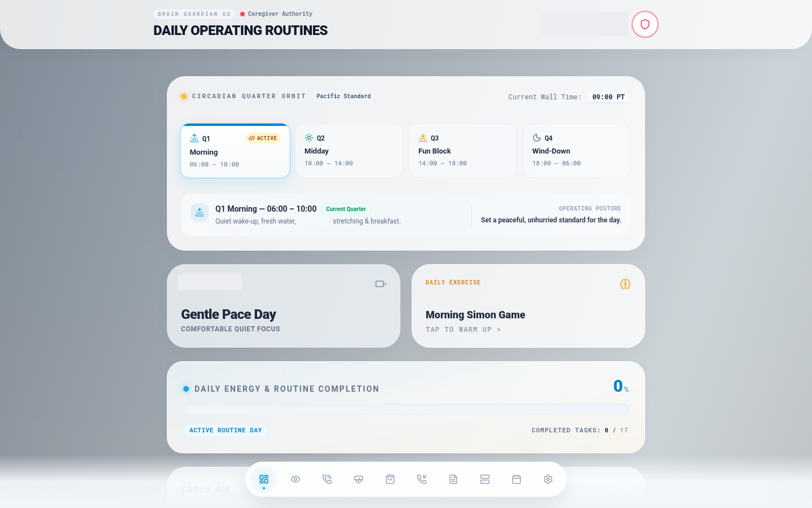

# Veteran Daily Routine Tracker

| | |
| --- | --- |
| Status | Prototype |
| Approx. date | Long-lived. Entries in the export run from January 15, 2026, through August 18, 2026. |
| Screenshot | [Daily operating routines](screenshots/veteran-daily-routine-tracker.png) |

Public name for this app. It was built as a daily routine tracker for a Veteran family member. The capture below is the scrubbed routines screen. Private family and health detail that existed in the export's data file is omitted.

## What it claims

A daily operating picture: quarter-of-day schedule, exercise, a short cognitive game, and a completion meter. The chrome identifies the screen as Brain Guardian OS under caregiver authority.

## What the source does

The largest caregiving app in the set: about 6,200 lines across 29 files. The logic that is real includes:

- Task and log persistence in local storage.
- An alarm hook that uses browser notifications.
- A quarter-of-day routine engine.
- A caregiver journal and a call-session view.
- A voice-companion studio.
- A budget and shopping feed.
- Cognitive mini-games.
- A Capacitor Android build.

The captured frame shows the routine engine in a morning quarter (Pacific time), a quiet-focus block, a Simon-style warm-up, and a completion bar at the start of a routine day.

This studio app is the direct UI ancestor of the later BrainGuardian system. That system is in a private repository and is not published here. See [sources](../sources.md).

## Stack

Vite. Local storage for tasks and logs. Browser notifications. Capacitor for an Android shell. About 6,200 lines, 29 files.

## What it shows

The governance habit applied to care: a schedule, a local record, and alarms, with the operator (the caregiver) in authority. It is also the product-architecture bridge from the market consoles to the private caregiving system. The studio export itself stays a prototype in this record.

